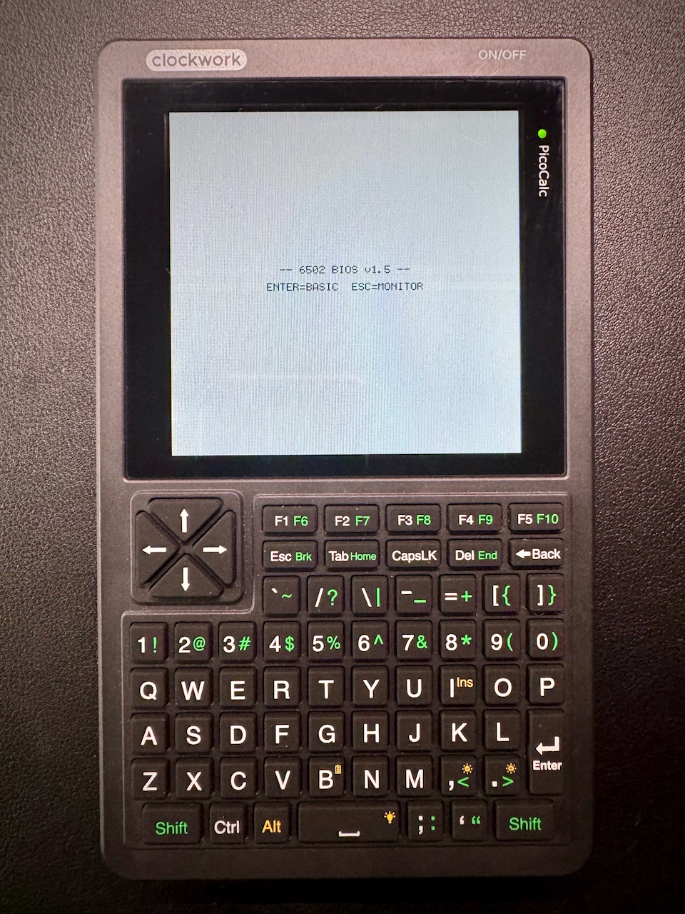

# 6502-PICOCALC



The **[A.C. Wright AC6502](https://github.com/acwright/6502-ACE)** — a 65C02
machine with a TMS9918 VDP, a SID, a 6522 VIA, a 6551 ACIA, a DS1511Y clock and
a CompactFlash card — running on a
[ClockworkPi PicoCalc](https://www.clockworkpi.com/picocalc), as a complete
replacement for the device firmware.

One `.uf2`, no host needed: it boots the real 32 KB BIOS ROM byte-for-byte,
probes its I/O slots, shows the splash, and drops into BASIC.

> 📖 **Guide:** [AC6502 Documentation](https://acwright.github.io/6502-DOCS/) —
> the user's and programmer's guide for the whole family. Everything the machine
> itself does — BASIC, the Monitor, the BIOS calls, the I/O cards — is documented
> there; this README covers only what is particular to the PicoCalc port.

---

## Hardware Emulation

The same machine the desktop emulator runs, on two RP2040/RP2350 cores: Core 0
is the 6502 and its I/O cards, Core 1 rasterises the VDP to the LCD and
synthesises the SID.

| Component | Details |
|---|---|
| **CPU** | W65C02S via [vrEmu6502](https://github.com/visrealm/vrEmu6502), full opcode set, IRQ / NMI |
| **RAM** | 32 KB system RAM + banked expansion (see [Pico 1 vs Pico 2](#pico-1-vs-pico-2)) |
| **ROM** | 32 KB BIOS **v1.6** in flash, replaceable from the SD card (see [The ROM socket](#the-rom-socket)) |
| **Cartridge** | 16 KB flat, or 128 KB – 1 MB banked (Flash Cart), held in flash (see [Flash carts](#flash-carts)) |
| **Video** | TMS9918A VDP, 16 KB VRAM — rendered to the PicoCalc's 320×320 LCD |
| **Audio** | MOS 6581 SID — synthesised to the PWM speaker pins |
| **Serial** | 6551 ACIA — bridged to USB CDC *and* the side-header UART, both live at once |
| **Storage** | CompactFlash 8-bit IDE — `CF.IMG` on the SD card, 256 × 1 MB banks |
| **RTC / NVRAM** | DS1511Y+ — clock plus 256 B of NVRAM, kept in flash, with burst mode for the BIOS's save slots |
| **GPIO** | 6522 VIA — keyboard on port B, fed from the PicoCalc's I2C keyboard, plus a joystick on each port |

Four places knowingly differ from the reference: the VDP status register's
fifth-sprite and collision bits always read 0 (sprites are rasterised on the
other core); the emulated CPU is not paced to a fixed clock rate — it runs as
fast as the board manages; a byte that arrives while the ACIA's receiver is
off waits on the link instead of being lost on the wire, which only matters for
the few hundred cycles between reset and the BIOS's `InitSC`; and a flash
cartridge's program and erase complete instantly, which is a consequence of the
second one and is worth reading [Flash carts](#flash-carts) about if you are
writing a cartridge that programs itself. Nothing in the BIOS or BASIC depends
on any of them.

The ACIA sits on the standard Serial Card with its `CTS EN` jumper at ground,
as every board is built: CTS, DCD and DSR are all tied low. Here that is the
only honest model, not just a default, because neither the USB console nor the
side header carries RTS or CTS wires, so nothing on the other end could drive
those lines. So CTS never stops the transmitter and DCD never stops the
receiver. There is no card picker, no jumper setting and none of the Serial
Card Pro's lines.

It is otherwise the Rockwell R6551 exactly, down to the parts of it that
firmware can hang on: DSR and DCD are active low and both read 0; clearing DTR
(command bit 0) turns the receiver, the transmitter and the interrupts off; and
a TIC of `00` (command bits 3-2) raises RTS *and* stops the transmitter, so a
byte written then sits in the transmit register with TDRE clear until RTS comes
back down. That last one was proved on the bench against a real R6551, and the
embedded BIOS v1.6 below is the reissue that copes with it. Receiver echo mode
(command bit 4) sends each byte back out of both links, as it does for any byte
the machine sends. Before v1.0.5 the echo went to the USB console only.

The embedded ROM is BIOS **v1.6**, the last 1.x release. The PicoCalc is a
TMS9918A machine and stays on the 1.x line, so this is the BIOS it keeps. 1.6
adds the Kernal's NVRAM save slots: 16 slots of 14 bytes, each with an owner ID
and a checksum. The NVRAM here is flash-backed, so saves survive a power cycle
like the battery-backed part. A change is committed about two seconds after
the last write, so a save needs that long before power is cut.

The image is the `v1.6` tag's `BIOS.bin` (SHA-256
`4b4154af…e210d8c56`), which was reissued to fix the serial flow control
against a real R6551. Only the Kernal's serial code moves, so nothing this port
reads by address changes. Re-embed it with:

```
./embed-rom.sh                # re-read the v1.6 tag from a sibling 6502-BIOS
./embed-rom.sh --check        # fail if the embedded bytes are not that tag's
```

### The ROM socket

**Load ROM** in the launcher puts a 32 KB image from `/ROMs` into flash and the
machine boots that instead of the built-in BIOS, the way a replacement chip in
the socket would. It stays there until **Restore built-in BIOS** takes it out.

A ROM loaded this way **survives a firmware update**. The `.uf2` rewrites the
firmware at the bottom of flash; the ROM image and the record naming it live at
the top and are not touched. That is the right behaviour for a chip in a
socket — and it is also a trap, because a firmware release whose point is a new
built-in BIOS will come up still running the old ROM.

Two things guard against it:

- The launcher's header names the built-in BIOS **with its version** —
  `ROM:  BUILT-IN BIOS v1.6` — so what is actually running is readable at a
  glance, and so is the name of a loaded ROM when one is in the socket.
- The firmware remembers which built-in BIOS a ROM was loaded over. If a later
  firmware ships a different one, the machine says so on screen at boot: it
  names the ROM, says the built-in BIOS is newer, and points at **F1 → Restore
  built-in BIOS**. Any key dismisses it, and it clears itself after ten
  seconds, so an unattended boot is never held up. It is shown once per
  power-on and keeps coming back while it is still true; restoring the built-in
  BIOS, or loading the ROM again over the current BIOS, ends it. The same
  warning sits on the launcher's header in the meantime.

Upgrading from **v1.0.3 or earlier** clears the ROM socket once, on first boot:
those builds recorded no BIOS to compare against, so every machine that had ever
loaded a ROM was silently running it. Such a machine comes up on the built-in
BIOS v1.6, which is what flashing a firmware release is meant to mean. The image
is still in flash and the file is still on the SD card — **Load ROM** puts it
back. **A loaded cartridge is not affected**, and neither are settings, NVRAM or
`CF.IMG`.

The serial console names the ROM at boot too:

```
ROM: built-in BIOS v1.6
```

### Flash carts

A cartridge image in `/Carts` is one of six sizes, and **the size decides how it
is mapped** — never the name. Up to 32 KB is the flat cartridge this machine has
always taken: 16 KB of code at `$C000–$FFFF`, either on its own or as the top
half of a 32 KB EEPROM image. 128 KB, 256 KB, 512 KB and 1 MB are a **Flash
Cart**, mapped by a bank register. Any other length is refused, because it is
not an image of a chip.

The name is a label. `Game-512K.crt` that is 262,144 bytes long loads as a
256 KB cart, and the launcher says so rather than refusing it.

A banked cart is one or two SST39SF0x0 flash chips behind an 8-bit register:

- `$C000–$DFFF` is an 8 KB **window** onto whichever bank the register selects.
- `$E000–$FFFF` is the **fixed region** — always the primary chip's last 8 KB,
  whatever the register holds. The reset and interrupt vectors live there, so
  they can never be banked out from under the CPU.
- A write anywhere in `$E000–$FFFF` latches the register and reaches no flash.
  A reset clears it, because the register's `/MR` is on `RESB`.
- A write to `$C000–$DFFF` is a flash write, which does something only as part
  of a JEDEC command sequence — so a cartridge can program and erase itself,
  exactly as it does on the board.

The image lives in the Pico's own flash, in a megabyte reserved for it, and is
read straight through XIP — the same cost the BIOS ROM pays. **That flash is the
cartridge's chip in this metaphor**, so a save a game writes is already
non-volatile: it survives a power cycle with no machinery at all, and the `.crt`
on the SD card is never written. Re-loading the cartridge from the SD card is
how a save is thrown away.

`Carts/<name>.sav` exists to carry a save somewhere else — to the desktop
emulator, or onto a real chip with `6502-flash merge`. It is written on eject,
and from **Save cart data** in the launcher. Its header carries the `.crt`'s size
and CRC-32, so a save can never be laid over a different build of a cartridge:
rebuild the cart and the launcher reports the save as belonging to another build,
starts the cart without it, and leaves the file on the card.

The record of *which* sectors to write out lives in RAM, so a power cycle forgets
it. The save itself does not go anywhere — it is in flash, and the cartridge
still reads it — but writing a sidecar is something to do in the session that
made the save.

**The knowing difference:** program and erase complete instantly here. The
emulated CPU is not paced to a fixed clock, so there is no cycle count to hang a
busy window on. Both standard polling loops still terminate, so ordinary save
code works — but a routine that programs the chip while *running from it* works
here and hangs on real hardware, where a busy chip answers every read with status
bits, the vectors included. The desktop emulator models the busy window and is
where that bug is meant to be caught.

The naming scheme, the mapper, the command set and the `.sav` container are
specified in 6502-VCS `PLAN.md` §§1–4, which three emulators and one programmer
all implement. The tests in [`test/cart/`](test/cart/README.md) check this one
against that rollout's shared fixture, on a desktop.

---

## Requirements

- A Pico SDK toolchain (`arm-none-eabi-gcc`), CMake, and Ninja.
- The SDK itself is vendored in `pico-sdk/`, so there is nothing to fetch.

`build.sh` sets `PICO_SDK_PATH` for you and prepends the toolchain to `PATH`.
It defaults to `~/toolchains/arm-gnu-toolchain-15.2.rel1-darwin-arm64-arm-none-eabi/bin`
(a plain tarball extract — the Homebrew cask installs via a GUI pkg installer
that can't be authorised headlessly). Point `TOOLCHAIN_BIN` somewhere else if
yours lives elsewhere:

```sh
TOOLCHAIN_BIN=/path/to/arm-none-eabi/bin ./build.sh
```

## Building

```sh
./build.sh          # both boards
./build.sh pico     # just the Pico 1 (RP2040)
./build.sh pico2    # just the Pico 2 (RP2350)
```

The board name is passed straight through as `PICO_BOARD`. Output lands in:

- `build/6502-picocalc-pico.uf2` — Pico 1 / RP2040
- `build/6502-picocalc-pico2.uf2` — Pico 2 / RP2350

## Flashing

1. Unplug the Pico, hold **BOOTSEL**, and plug it back in.
2. It mounts as a USB drive (`RPI-RP2` on a Pico 1, `RP2350` on a Pico 2).
3. Copy the matching `.uf2` onto it. The board reboots into the firmware by
   itself.

**Flash the UF2 that matches your board** — they are not interchangeable, and
each board only accepts its own. If you are unsure which one is already on a
board, open a serial terminal: the banner names it.

Flashing replaces the firmware only. Settings, NVRAM, the cartridge slot and
anything on the SD card carry over — as, up to v1.0.3, did a ROM loaded from
the SD card, which is worth reading [The ROM socket](#the-rom-socket) about
before assuming a new firmware means a new BIOS.

```
6502-PICOCALC (board=pico, clk_sys=200000 kHz)
```

---

## SD card

The launcher expects three folders, and offers to create any that are missing:

```
/Programs     .bas / .prg program images, loaded to $0800
/Carts        cartridge images (.crt) and the saves they write beside them
              (.sav) — see Flash carts
/ROMs         32 KB BIOS replacements (see The ROM socket)
/CF.IMG       the emulated CompactFlash card (created on first boot)
```

`CF.IMG` is what BASIC's `LOAD`, `SAVE`, `DIR` and `BLOAD`/`BSAVE` work
against. It starts one 1 MB disk bank long and grows a bank at a time as
higher disks are used, so all 256 are addressable without pre-filling 256 MB
over SPI. Images can also be built on a desktop with
[`cffs`](https://github.com/acwright/cffs).

The card answers as a real CompactFlash card does, as the desktop emulator's
does: ready reads `$50`, IDENTIFY is laid out as a card sends it, a count of 0
moves 256 sectors, and a command written during a transfer ends it. The tests in
[`test/storage/`](test/storage/README.md) check it on a desktop.

Files list under the names they were written with: FatFs is built with
long-name support, so `Space Invaders.bas` appears as itself rather than as
`SPACEI~1.BAS`. Names longer than 31 characters are truncated on screen, which
no cartridge name comes close to.

## First boot

The mainboard's power rail — LCD, keyboard controller, SD slot — only comes up
when the PicoCalc's **power button** is pressed. If you power the Pico module
through its own USB port (for the serial console), the RP2040 starts running
several seconds before the rest of the board exists. The firmware waits for the
keyboard controller to answer before touching the SD card, so this resolves
itself; the wait shows up in the boot log and is not an error:

```
boot: kbd_wait_ready           t+4492ms
```

If the controller never answers, it gives up after 5 seconds and carries on, so
a bare Pico with no PicoCalc attached still boots.

---

## Controls

**F1** opens the launcher at any time — even if a cartridge has hung the
machine, since it runs outside the emulated CPU. From there you can load
programs, cartridges and ROMs, eject what's in a slot, change settings, and
reset.

In the launcher: arrows move, **Enter** selects, **Esc** goes back. On the
settings screen, **Left/Right** change the highlighted value.

Two ways to restart the machine, matching the desktop emulator:

- **Reset machine** — the reset button. RAM keeps its contents, so a BASIC
  program in memory survives and can be `RUN` again.
- **Power cycle** — as if the power had been off. RAM is cleared and BASIC
  comes up cold.

Anything saved to `CF.IMG` survives both, as does whatever is in the ROM socket
and cartridge slot — those live in flash, like the chips they stand in for, and
survive a firmware update as well. See [The ROM socket](#the-rom-socket) for
what that means when an update brings a new built-in BIOS.

## Settings

Stored in flash and applied on every boot:

| Setting | Notes |
|---|---|
| Clock speed | Stock or 200 MHz. Takes effect on the next power-on. |
| Expansion RAM | Narrows the IO 1 card below what the build fitted. |
| Backlight | Applied as you adjust it. |
| Sleep after | Blanks the backlight when idle; any key brings it back. The machine keeps running. |

Sleep is a backlight blank, not a suspend — the 6502 carries on, audio keeps
playing, and the serial console stays live.

---

## Pico 1 vs Pico 2

Both are supported and boot the same machine. The differences come from SRAM:

|  | Pico 1 (RP2040) | Pico 2 (RP2350) |
|---|---|---|
| SRAM | 264 KB | 520 KB |
| Expansion RAM (IO 1) | 16 banks / 16 KB | 256 banks / 256 KB |
| Expansion RAM (IO 2) | absent | absent |
| Cartridge region | 1 MB reserved | 1 MB reserved |

Both boards reserve the same megabyte for a cartridge and both take every size,
so a cart that runs on one runs on the other.

The BIOS probes every slot, so both boot correctly — only the amount of paged
RAM differs, and `MEM` reports what answered. BASIC itself only ever uses
BANK 0, which lives in system RAM, so it is unaffected either way.

**On speed:** the BIOS ROM is read from flash over XIP rather than copied into
RAM (there isn't room on either board — see the note in
[`src/machine/machine.c`](src/machine/machine.c)), which is the dominant cost in
the emulated CPU's throughput. Expect a boot-to-BASIC of around 30 seconds on a
Pico 1 rather than the second or two the real hardware takes. It is slow, but
it is stable, and everything else works as it should.

---

## Project Structure

```
src/
  cpu/vrEmu6502/  Troy Schrapel's 6502 core, vendored
  machine/        The machine: bus, cards (video, sound, serial, via, rtc,
                  storage, ram_bank), media, settings, and the Core 1
                  video rasteriser and SID synthesiser
  rom/            The BIOS image, embedded in flash
  lcd/  kbd/  sd/ PicoCalc hardware drivers (SPI panel, I2C keyboard, SD)
  fatfs/          FatFs, for the SD card
  launcher/       The F1 launcher — file browser, slots, settings
  main.c          Boot, the Core 0 run loop, and the USB CDC console
test/cart/        The cartridge mapper's tests, on a desktop
test/storage/     The CompactFlash card's tests, on a desktop
build.sh          Configures and builds the .uf2 for one or both boards
embed-rom.sh      Regenerates src/rom/bios_rom.c from a 6502-BIOS tag
```

---

## Related

- [6502-ACE](https://github.com/acwright/6502-ACE) — the real machine, and the index of the whole family
- [6502-DOCS](https://github.com/acwright/6502-DOCS) — the user's and programmer's guide ([read it here](https://acwright.github.io/6502-DOCS/))
- [6502-BIOS](https://github.com/acwright/6502-BIOS) — firmware source; the ROM embedded here is its `v1.6` build
- [6502-EMULATOR](https://github.com/acwright/6502-EMULATOR) — the desktop and web emulator, and the reference this port's I/O cards match
- [6502-DEV](https://github.com/acwright/6502-DEV) — the Teensy development firmware this port's structure came from
- [6502-PRG](https://github.com/acwright/6502-PRG) / [6502-CRT](https://github.com/acwright/6502-CRT) — templates for the programs and cartridges the launcher loads
- [6502-ASM](https://github.com/acwright/6502-ASM) / [6502-BAS](https://github.com/acwright/6502-BAS) — example programs and BASIC listings to run
- [cffs](https://github.com/acwright/cffs) — builds the `CF.IMG` CompactFlash images
- [bastok](https://github.com/acwright/bastok) — tokenizes BASIC listings into the `.prg` images the launcher accepts

## Credits

- 6502 core: [vrEmu6502](https://github.com/visrealm/vrEmu6502) by Troy Schrapel (MIT)
- LCD, keyboard and SD reference code: [clockworkpi/PicoCalc](https://github.com/clockworkpi/PicoCalc)
- SD card filesystem: [FatFs](http://elm-chan.org/fsw/ff/) by ChaN

## Contributing

This port pairs with the hardware, firmware and emulator linked above.
Contributions, issues, and feature requests are welcome!
